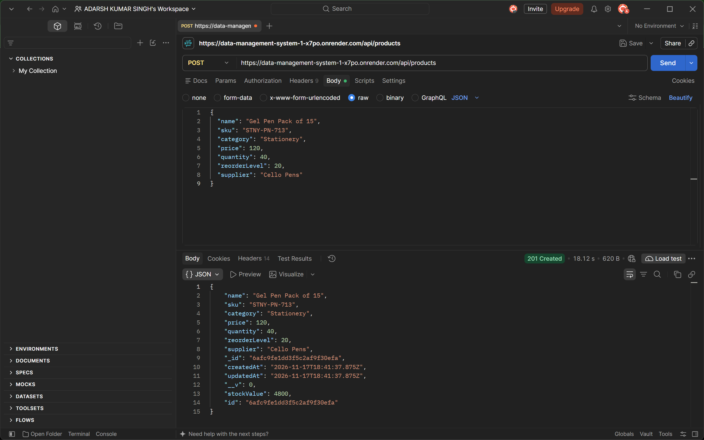
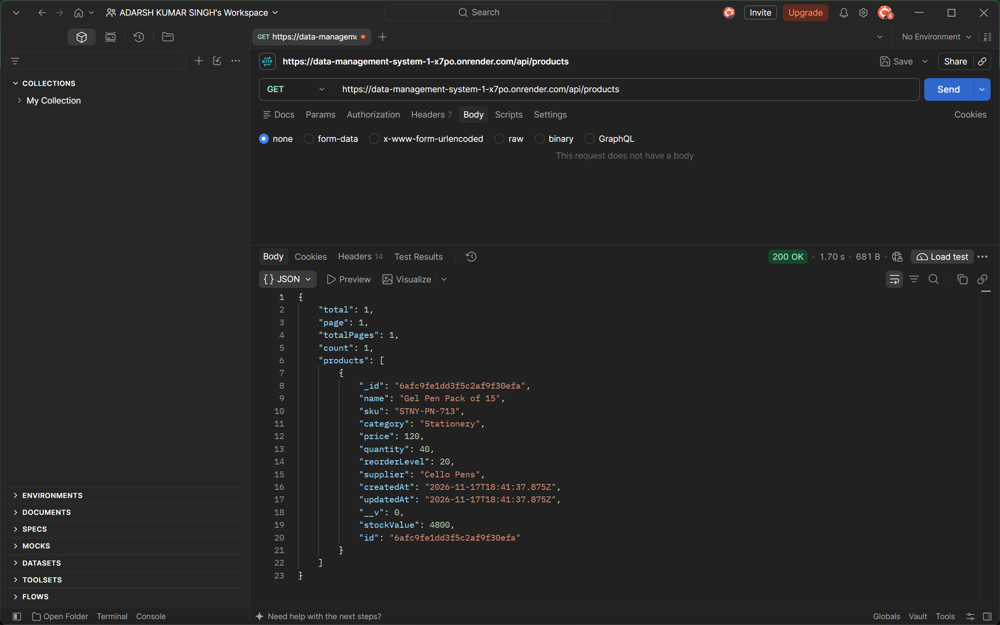
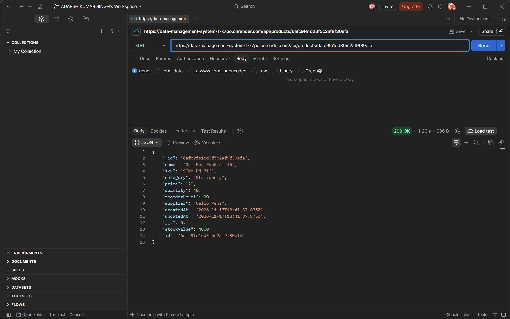
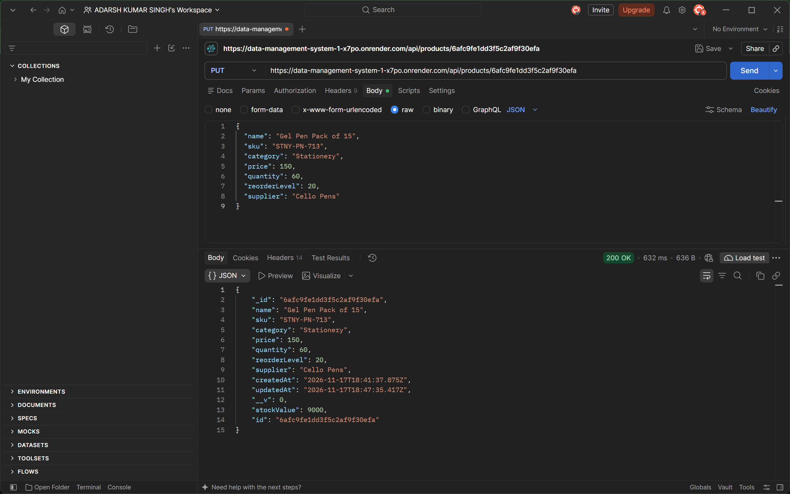
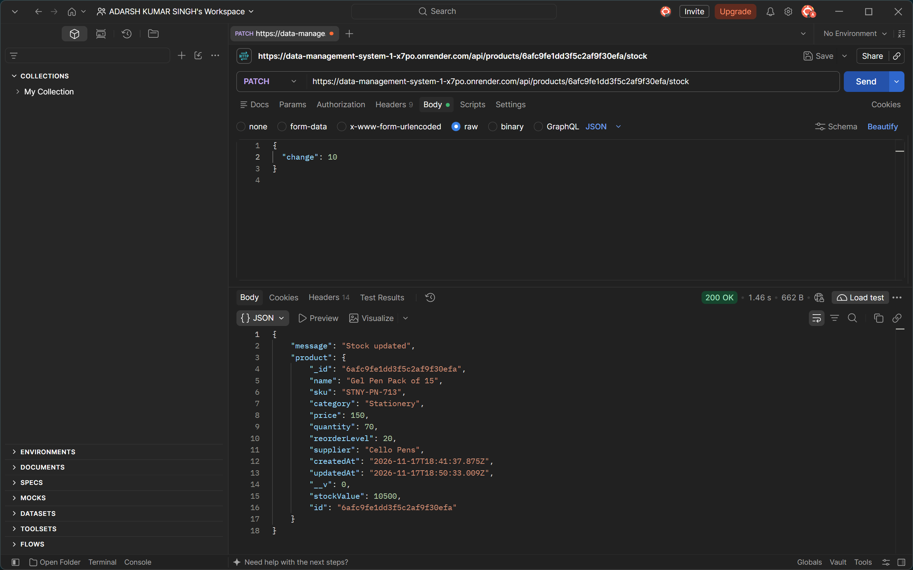
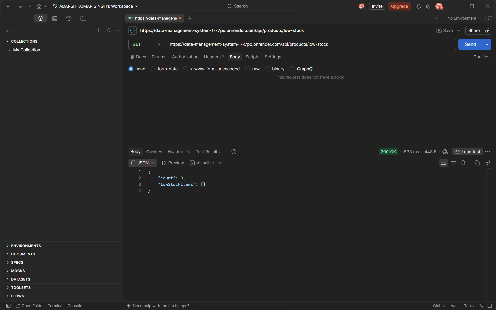
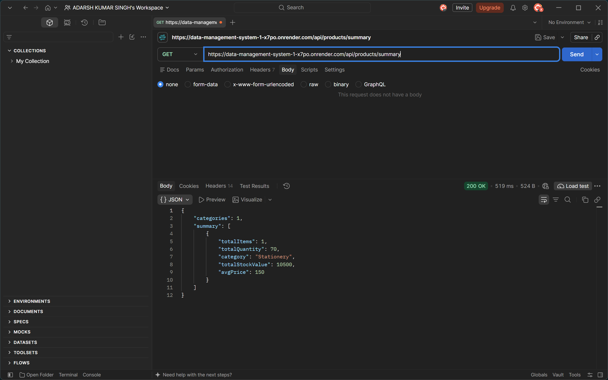
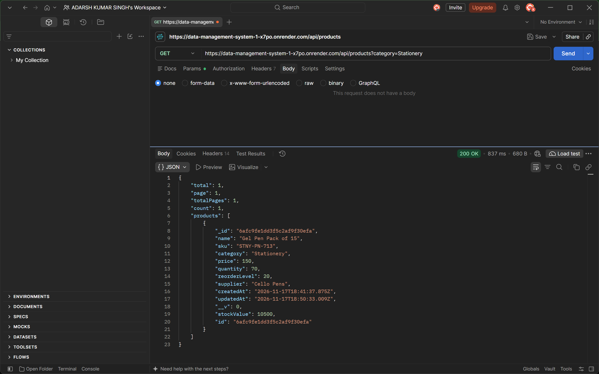
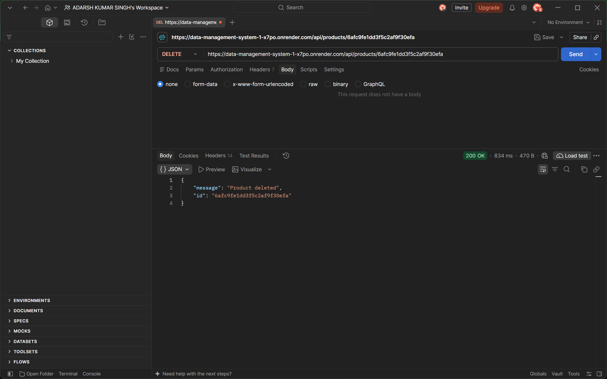

# Assignment 3 – Inventory and Data Management System

**Technology:** Node.js, Express.js, MongoDB, Mongoose

## Features
- Product CRUD operations
- Schema validation
- Filtering, sorting and pagination
- Stock adjustment
- Low-stock alerts
- Category-wise inventory summary using aggregation
- Centralized error handling

**Server:** `http://localhost:5000`

## Postman API Testing

### 1. Create Product

### 2. Get All Products

### 3. Get Product by ID

### 4. Update Product

### 5. Stock Adjustment

### 6. Low Stock Report

### 7. Category-wise Inventory Summary

### 8. Filtering, Sorting and Pagination

### 9. Delete Product

## Conclusion

The Inventory and Data Management System successfully implements RESTful APIs for product management, stock operations, filtering, pagination and MongoDB aggregation.

All API endpoints were tested successfully using Postman.

---

**Assignment 3 | Web Development III**